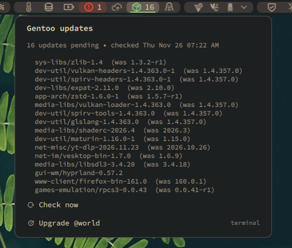

# eupdates

[](https://github.com/joshtreed/eupdates/actions/workflows/ci.yml)
[](LICENSE)

Shows how many Gentoo packages have pending updates, in any status bar.



```
$ eupdates
15
$ eupdates list
sys-libs/zlib-1.4  (was 1.3.2-r1)
dev-libs/expat-2.11.0  (was 2.10.0)
...
```

eupdates runs the same resolve as `emerge -uDN @world`, so the count matches
what an upgrade would actually merge. That takes a minute or two, so the
result is cached and refreshed in the background. Reading the count only
reads the cache, so bars can poll it as often as they like.

- Works with any bar: plain text, a `--format` template, or JSON; poll it or
  stream it.
- No timer, cron job or service to set up. It notices syncs, emerges and
  config changes on its own.
- Syncs for you. If nobody has synced the tree in two days, it keeps a
  verified copy of its own, synced at most once a day.
- One C file, no dependencies beyond portage.

## Install

```sh
make
sudo make install    # installs to /usr/local; use PREFIX=/usr to change
```

Building needs a C11 compiler and `scdoc` for the man page. `glsa-check`
(from gentoolkit) is optional; with it, eupdates also counts security
advisories that affect you.

## Usage

```
eupdates                 print the cached count and exit
eupdates watch           keep running, print a new line when the count changes
eupdates check           resolve @world now and refresh the cache
eupdates list            list pending packages
eupdates upgrade         run an emerge upgrade in $TERMINAL, then re-check
```

Output is set with `--format`, using the fields `{count}`, `{glsa}`,
`{synced}` (age of the tree snapshot in days) and `{state}`:

```sh
eupdates --format '{count} updates, synced {synced}d ago'
```

`--json` prints one JSON object per line (`text`, `tooltip`, `class`, `alt`),
the shape waybar expects. `--notify` sends a desktop notification when the
count goes up.

See `eupdates(1)` for every option and environment variable.

## Status bars

| Bar | Setup |
|---|---|
| waybar | [contrib/waybar](contrib/waybar/) |
| polybar | [contrib/polybar](contrib/polybar/) |
| i3blocks | [contrib/i3blocks](contrib/i3blocks/) |
| tmux | [contrib/tmux](contrib/tmux/) |
| anything else (conky, dwm, eww, yambar, ...) | [contrib/generic](contrib/generic/) |

Bars that run a command on an interval use `eupdates`. Bars that read a
long-running command use `eupdates watch`.

## When it checks

Each time a bar asks for the count, eupdates checks whether the cache is out
of date. If it is, eupdates starts one low-priority check in the background and
shows the old count until the check finishes. The cache is out of date when,
since the last check:

- a repository was synced (the gentoo tree or an overlay, rsync or git),
- something under `/etc/portage` changed,
- an emerge finished,
- the world file changed, or
- 24 hours went by (`EUPDATES_MAX_AGE`).

If no one has synced a repository in two days, the check first syncs
eupdates' own copy of it (in `~/.cache/eupdates/repos`), at most once a day and
verified the way `emerge --sync` verifies it. The count then comes from that
copy, and `eupdates upgrade` runs `emerge --sync` before upgrading. The first
copy of the gentoo tree takes as much disk as the system one (about 600 MB).
Use `--no-sync` (or `EUPDATES_SYNC=0`) if you sync yourself and don't want the
copy.

It waits while `emerge` or `emaint` is running, and runs only one check at a
time. If a check fails (an unresolved blocker, say), the last good count stays
and it doesn't retry until something changes.

To schedule checks yourself, use `--no-auto` (or `EUPDATES_AUTO=0`) and run
`eupdates check` from cron or a timer.

## Contributing

See [CONTRIBUTING.md](CONTRIBUTING.md). Changes are listed in
[CHANGELOG.md](CHANGELOG.md).

## License

GPL-3.0-or-later. See [LICENSE](LICENSE).
